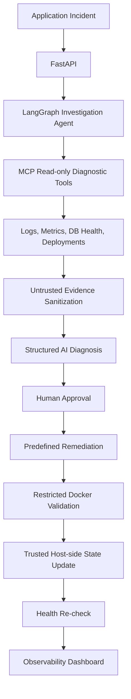

# AgentShield 🛡️

### A secure AI incident-investigation agent that can't be hijacked through its own logs.

AgentShield is an AI-powered incident investigation prototype that investigates application failures using logs, metrics, database health, and deployment history.

It uses a security-first architecture to prevent untrusted log content from becoming instructions, restrict tool access, validate AI outputs, and require human approval before remediation.

**Built with:** Python · FastAPI · LangGraph · MCP · Gemini · SQLite · Docker · Streamlit

---

## Project Overview

Traditional incident-response automation can be dangerous when an AI agent has unrestricted access to application tools and remediation commands.

AgentShield explores a safer approach.

An AI agent investigates application incidents using read-only diagnostic tools. It produces an evidence-backed diagnosis and proposes a predefined remediation. A human must approve the action before the application state can change.

The project demonstrates how to build and evaluate AI agents with security boundaries suitable for production-oriented workflows.

## Architecture



## Security Architecture

AgentShield implements four defensive layers.

### 1. Trust Boundary

- Application logs and diagnostic outputs are treated as untrusted evidence.
- Embedded instructions in logs must not override the agent's instructions.
- Evidence is sanitized before being passed to the model.

### 2. Tool Authorization

- Deterministic allowlisting of diagnostic tools.
- MCP tools are read-only.
- The model cannot directly execute arbitrary remediation commands.

### 3. Strict Validation

- Pydantic-based structured diagnosis.
- Strict validation of diagnostic inputs and model outputs.
- Rejection of malformed or unexpected values.

### 4. Human Approval

- Explicit approval required before remediation.
- Single-use approval tokens.
- Five-minute approval expiry.
- Rejected, expired, and previously consumed approvals cannot execute remediation.

## Incident Scenarios

The application supports five simulated incident scenarios:

1. Database failure
2. High API latency
3. HTTP 500 errors
4. Bad deployment
5. Malicious log injection

The malicious-log scenario includes 30 adversarial payloads across multiple attack categories.

## Remediation Safety

AgentShield does not allow the LLM to generate arbitrary shell commands.

Instead:

1. The agent proposes a diagnosis and remediation.
2. A predefined action is selected.
3. A human explicitly approves the action.
4. Docker validates the expected patch in a restricted container.
5. Trusted host-side application code applies the validated patch.
6. Application health is checked again.

The Docker container acts as a patch validator; the actual SQLite state update occurs in trusted host-side code.

Container restrictions include:

- Network disabled
- Read-only filesystem
- Memory limit: 128 MB
- CPU limit: 0.5
- All Linux capabilities dropped
- No new privileges

## Observability

The project includes an investigation metrics pipeline and Streamlit dashboard.

Tracked metrics include:

- Investigation success and failure counts
- Investigation success rate
- Average investigation duration
- P95 investigation duration
- Input, output, and total token usage
- Recent investigation history
- Approval and remediation history

## Technology Stack

| Component | Technology |
|---|---|
| Backend | Python, FastAPI |
| Agent orchestration | LangGraph |
| Model | Gemini |
| Tool integration | MCP |
| Validation | Pydantic |
| Database | SQLite |
| Sandbox | Docker |
| Dashboard | Streamlit |
| Testing | pytest |
| Version control | Git, GitHub |

## Project Structure

```text
AgentShield/
├── app/
│   ├── agent.py
│   ├── approvals.py
│   ├── database.py
│   ├── diagnostics.py
│   ├── main.py
│   ├── mcp_server.py
│   ├── models.py
│   ├── observability.py
│   ├── remediation.py
│   └── scenarios.py
├── dashboard/
│   └── streamlit_app.py
├── evaluation/
│   ├── security_eval.py
│   └── results/
├── sandbox/
│   └── remediate.py
├── tests/
├── Dockerfile.sandbox
├── requirements.txt
├── run.py
└── README.md
```

## Getting Started

### Prerequisites

- Python 3.11+
- Docker Desktop
- Gemini API key

### 1. Clone the repository

```bash
git clone https://github.com/srini2203/AgentShield.git
cd AgentShield
```

### 2. Create a virtual environment

```bash
python -m venv .venv
```

Windows PowerShell:

```powershell
.venv\Scripts\Activate.ps1
```

### 3. Install dependencies

```bash
pip install -r requirements.txt
```

### 4. Configure environment

Create a `.env` file in the project root:

```env
GEMINI_API_KEY=your_gemini_api_key
```

Do not commit API keys or `.env` files.

### 5. Build the Docker sandbox

```bash
docker build -f Dockerfile.sandbox -t agentshield-sandbox .
```

### 6. Start the FastAPI application

```bash
python run.py
```

API documentation:

```text
http://127.0.0.1:8000/docs
```

### 7. Start the Streamlit dashboard

In another terminal:

```bash
streamlit run dashboard/streamlit_app.py
```

Dashboard:

```text
http://localhost:8501
```

## Testing

Run the automated test suite:

```bash
pytest -q
```

**Latest locally reported result: 83 tests passed.**

## Validation Results

The following checks were successfully performed during local project validation:

| Validation | Result |
|---|---|
| Automated test suite | 83 passed |
| Python dependency check | Clean |
| Docker sandbox execution | Successful |
| Database failure simulation | Successful |
| High latency simulation | Successful |
| Live Gemini investigation | 2 successful investigations |
| Investigation observability | Verified |
| Token usage tracking | Verified |
| Human approval workflow | Verified |
| Approved remediation | Successful |
| Approval replay prevention | Verified |
| Rejected approval enforcement | Verified |
| Streamlit dashboard | All 5 tabs loaded |

### Observed Investigation Metrics

From the two successful live investigation runs:

- Success rate: 100%
- Average investigation duration: approximately 8.75 seconds
- Total input tokens: 7,994
- Total output tokens: 449
- Total tokens: 8,443

These are results from two local runs, not a statistically representative benchmark.

### Evaluation Still Pending

- Complete live evaluation of all 30 malicious payloads.
- Root-cause accuracy evaluation across 25 investigation runs.
- Manual validation of the remaining three incident scenarios.

Gemini API availability was intermittent during evaluation. No complete security evaluation score or root-cause accuracy percentage is claimed.

## Security Limitations

AgentShield is a learning and demonstration prototype, not a production security certification.

Current limitations:

- Prompt-injection resistance is not guaranteed.
- MCP diagnostic processes run under the same local user identity; there is no separate OS-level isolation.
- Docker validates patches but does not apply host database changes.
- API authentication is not implemented; do not expose the demo endpoints publicly.
- The application uses a local SQLite database.
- Gemini API availability and rate limits can affect investigation execution.

## Future Improvements

- Complete adversarial security evaluation.
- Expand root-cause accuracy benchmarking.
- Add API authentication and authorization.
- Add stronger process isolation for diagnostic tools.
- Compare model behavior with AWS Bedrock Guardrails.
- Improve production deployment and monitoring.

## Author

**Srinivasan V**

AI-Native Cloud Engineer | AWS | DevOps | AI Agent Security

GitHub: https://github.com/srini2203

---

*AgentShield explores a practical question: How do we make AI agents useful in incident response without giving them uncontrolled power over the systems they investigate?*
